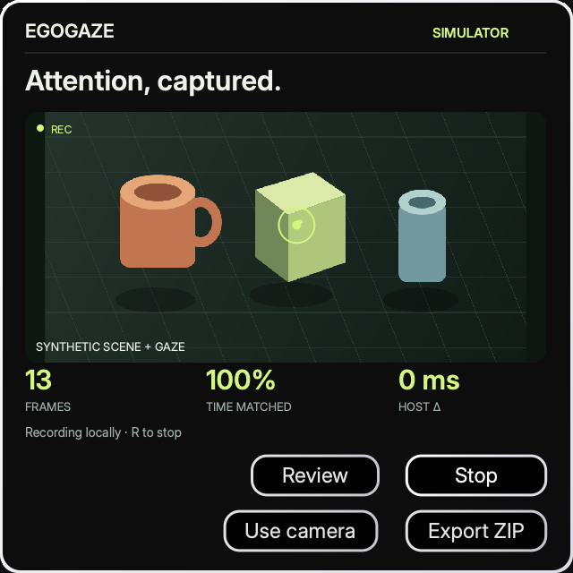
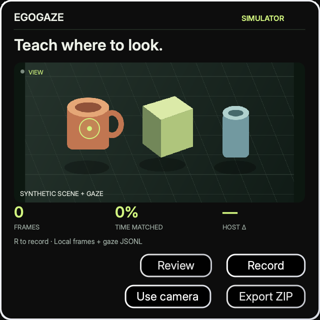
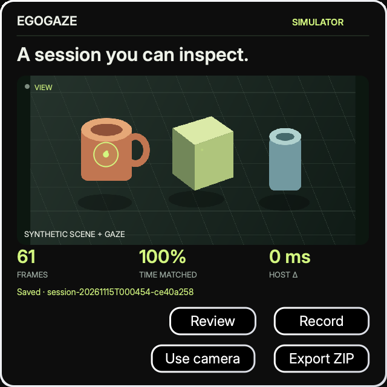
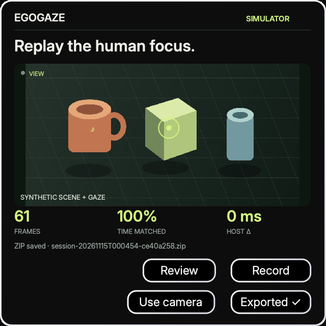

# EgoGaze

**Teach where to look.**

An egocentric data collection prototype for Raven Prism. Record a person's scene-camera frames alongside eye-tracking observations, inspect timing quality, replay a session, and export an open dataset for future attention-supervision research.



[Watch the English-narrated demo](media/demo.mp4) · [Inspect the synthetic sample session](sample-session) · [Dataset specification](DATASET.md)

## Run

Python 3.12 and Git are recommended. From this repository:

```sh
python3.12 -m venv .venv
git clone https://github.com/RavenResonance/raven-framework.git
.venv/bin/python -m pip install -e ./raven-framework
./run.sh
```

The default is a fully offline simulator with an original tabletop illustration and synthetic gaze. It exercises the same recorder, pairing, storage, replay, and export code as camera mode.

- **Record / Stop** starts and finalizes a local session. The **R** key does the same thing.
- **Review** replays the saved images and synthetic gaze, preserving the recorded host-receipt frame intervals.
- **Export ZIP** creates a portable archive beside the session folder. **E** also exports. The status line and its tooltip show the destination.
- **Use camera** selects camera mode. On Raven hardware this uses the Raven camera and EyeControl APIs. On a desktop it records the webcam with gaze marked unavailable. The camera starts only when recording begins and closes when recording stops.
- Recordings live in `~/Documents/EgoGaze/`. Set `GAZE_RECORDINGS_DIR` to change the location.

Raven hardware is detected automatically. If required, set `RAVEN_APP_ID` and `RAVEN_APP_KEY` through environment variables before starting. Packaging uses the framework's normal `.venv/bin/python main.py deploy` command. Device sensor access may require Raven entitlements.

## What is recorded

Each session contains unannotated JPEG frames, raw gaze observations in JSONL, per-frame associations, and a JSON manifest. Gaze and camera reads are timestamped in the same process using `time.monotonic_ns()`.

The dashboard shows frame count, the percentage of accepted host-time associations, and the latest absolute host-time delta. A visible recording state, explicit Stop control, and local export make the capture lifecycle inspectable.





## Coordinate and synchronization limits

**Real-device validation and robot training remain pending.** The SDK returns gaze coordinates and camera images without hardware timestamps or a camera-projection calibration. EgoGaze therefore records host-call intervals and reports approximate temporal association. An accepted association is not proof of synchronized camera exposure and eye measurement.

Device gaze is stored as `sdk_gaze_pixels_unverified`. Its 720×720 bounds come from the installed SDK display configuration and remain an explicit assumption. Real recordings always have `scene_gaze_xy: null` and `scene_projection_valid: false`. No gaze marker is drawn onto real camera imagery.

The demo uses `synthetic_scene_pixels` with a known identity mapping. Its visual attention trace illustrates how calibrated labels could be inspected. Raw exported JPEGs contain no gaze overlay. Missing observations remain `null`, confidence remains `null`, and poor associations are flagged rather than silently repaired.

After camera/eye calibration and real-device timing validation, this kind of dataset could support attention prediction or foveated perception. Robot policy learning additionally needs relevant action data and validation. See [DATASET.md](DATASET.md) and [RESEARCH.md](RESEARCH.md).

## Verify

```sh
.venv/bin/python -m unittest discover -s tests -v
```

Ten tests cover malformed gaze, coordinate bounds, missing observations, signed nearest-neighbor deltas, slow capture calls, invalid timestamp order, explicit device projection limits, session lifecycle, ZIP contents, record/replay/export, original playback timing, and restart protection while a camera worker is shutting down.

Camera I/O runs on a worker thread. New recording cannot begin until the old worker exits. The app waits for the camera worker at shutdown. Frame files and the manifest use temporary-file replacement. An interrupted session retains a `recording` manifest until successfully finalized, allowing incomplete sessions to be identified.

## Reproduce the media

Use a graphical desktop with the Raven simulator, FFmpeg, and Node 20 or newer. Copy `.env.example` to a private `.env` and provide a Cartesia API key.

```sh
node narrate.mjs
.venv/bin/python capture_demo.py
```

An external credential file is supported with `node narrate.mjs --env-file /path/to/private.env`.

The first command generates four English narration chapters and their measured timeline using Cartesia. The second opens the visible official Raven simulator through `RunApp.run()`. Qt timers drive recording, stop, replay, and export in real time, while the official simulator Record button captures its own composite view. The recording is saved through the standard Qt save dialog. FFmpeg trims the measured preroll and adds the narration. No external titles, captions, borders, or composited UI are added. The app remains in its visibly labeled simulator mode with synthetic scene and gaze. This is simulator footage, not hardware footage.

For manual recording control, run `.venv/bin/python live_demo.py --preroll 2 --record`. The official Save recording dialog appears when the demo ends. Use `--record-output /absolute/new-file.mp4 --exit-after-save` to save and close automatically. `RECORD_T0` and `DEMO_T0` logs provide the monotonic timing offset for narration alignment.

Development screenshot and dataset fixtures can be regenerated separately with `.venv/bin/python capture_fixtures.py`. This offscreen utility produces app-widget PNGs and the synthetic `sample-session/`, and never generates a video. Its sample manifest explicitly identifies the deterministic clock.

## Files

- `main.py` — Raven application, camera worker, synthetic scene, and replay.
- `dataset.py` — gaze validation, host-time association, session storage, and ZIP export.
- `DATASET.md` — schema, quality gates, sample reader, and calibration requirements.
- `RESEARCH.md` — research motivation and references.
- `live_demo.py` — real-time actions inside the official simulator and its recording/save controls.
- `capture_demo.py` — official live capture, preroll trimming, and narration muxing.
- `capture_fixtures.py` — development-only app-widget screenshots and synthetic dataset generation.
- `tests/` — recording, data-quality, and lifecycle regression checks.
- `media/` — screenshots, English transcript/timing, and narrated demo.
- `sample-session/` — an inspectable session containing only synthetic data.

## License

Application code, the original synthetic scene, and sample data are MIT licensed. Raven Framework is a separately installed proprietary dependency governed by its own license. Its source is excluded from this repository.
